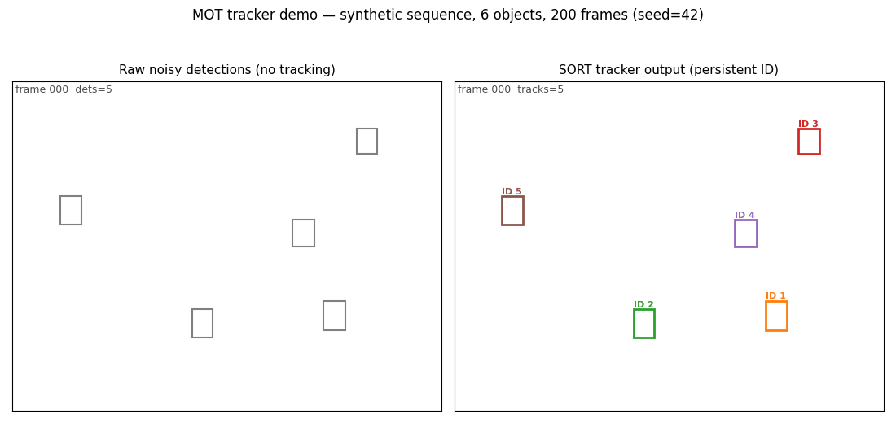

# MOT Tracker — SORT-style Multi-Object Tracking, from scratch



*Left: raw simulated detections (no identity, flicker with misses/false positives). Right: this tracker's output — colored boxes keep the same ID through crossings and occlusions.*

| | MOTA | IDF1 | MOTP | Notes |
|---|---|---|---|---|
| **Real MOT17** (public FRCNN detections, 4 train seqs) | **0.447** | **0.530** | 0.887 | 500–1700 FPS, CPU only |
| Synthetic stress test (200 frames, 6 objects) | 0.910 | 0.952 | 0.906 | 1 ID-switch / 1200 boxes |

Full breakdown, exact commands, and honest framing of every number → [`RESULTS.md`](RESULTS.md).

From-scratch: per-track constant-velocity **Kalman filter**, **IoU + Hungarian** data association, full track lifecycle (birth → confirm → coast → death), and a hand-written **CLEAR MOT / IDF1** evaluator validated against the reference `motmetrics` library.

## Quick start

```bash
pip install numpy scipy                # scipy optional (greedy fallback exists)
python run_smoke.py                    # synthetic sequence, measured MOTA/IDF1
python tests/test_basic.py             # self-tests (IoU, KF, metrics identity)
python make_demo.py                    # regenerate demo.gif
```

Real MOT17 benchmark (labels auto-download, ~a few MB, no image frames needed):

```bash
pip install numpy scipy motmetrics
python run_real.py
```

## What's inside

```
tracker/    kalman.py (7-D CV Kalman)  association.py (IoU+Hungarian)
            track.py (lifecycle)       sort.py (Sort tracker)  detectors.py
eval/       synthetic.py (GT + noisy-detector sim)  metrics.py (CLEAR MOT/IDF1)
            mot_io.py (MOTChallenge det/gt/results I/O)
run_smoke.py / run_real.py / run_mot16.py   entry points
tests/      dependency-free self-tests
```

## Algorithm notes
- **Kalman filter** — SORT's 7-D state `[u, v, s, r, u', v', s']` (center, area, aspect ratio + velocities).
- **Association** — IoU cost matrix + `scipy.optimize.linear_sum_assignment` (greedy fallback if scipy is absent), gated by an IoU threshold.
- **Lifecycle** — `n_init` hits to confirm a track, coast up to `max_age` frames on misses before deletion — survives brief occlusions/crossings without dropping IDs.
- Appearance re-ID (DeepSORT-style) is intentionally not enabled — noted as future work, not claimed.
